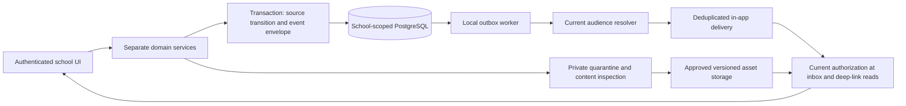

# Phase 10 engineering analysis — Communications and Learning Resources

**Date:** 6 November 2026 (Africa/Lagos). **Status:** analysis complete; design
selected for development, not implemented or accepted functionality.
**Requirements:** COM-REQ-001, LIB-REQ-001, AUD-REQ-001; supporting SEC-REQ-001,
USR-REQ-001, STU-REQ-001 and existing academic/publication requirements.
**Verified remote baseline:** `d4459d827e8529ea8daddb73f7e842d8c47c12ab`.
**Branch:** `analysis/phase10-communications-library-20261106`.
**Authority:** D-023 and the owner's explicit analysis task; no main merge,
production deployment, real recipients or external messaging activation.

## 1. Source of truth and inspected evidence

Remote main was fetched and independently compared with `git ls-remote` before
branch creation. It contains accepted Phases 8 and 9, including Phase 9 integration
PR #108 (`a20108c347ae3772eb848cc28bd0f32edb2e88ad`) and PR #109's documentation.
The previous Phase 9 development branch is preserved. This analysis changes only
documentation and introduces no executable code, dependency, schema or migration.

Canonical inputs read: AGENTS.md; documentation index; D-023; implementation
roadmap/current status/dependencies; functional requirements, traceability and
acceptance; announcements, assignments/e-library, audit/notifications and portals
modules; notification event catalog; authorization rules/matrix/roles and approval
workflows; security, privacy, file storage, retention, migration and invariant
specifications; module boundaries, system overview, tenancy, reliability, API
contracts, accessibility, local CI runbook and definition of done.

Evidence paths below are relative to the repository root. Findings concern the
actual baseline, not historical sections still labeled authored/unverified:

| Existing source                                                                                                                | Observed capability and reuse boundary                                                                                                                                                                                                           |
| ------------------------------------------------------------------------------------------------------------------------------ | ------------------------------------------------------------------------------------------------------------------------------------------------------------------------------------------------------------------------------------------------ |
| `src/lib/auth.ts`, `src/lib/db.ts`                                                                                             | Better Auth sessions, Prisma PostgreSQL driver adapter; reuse server-side identity, not browser role claims                                                                                                                                      |
| `src/modules/authorization/policy.ts`                                                                                          | Generic actions omit notice/library/notification permissions; `child:read` deliberately always denies. Do not enable it to implement Phase 10                                                                                                    |
| `src/modules/tenancy/context.ts`                                                                                               | Active school/member resolution, active teacher assignments, same-school active resource resolution for untyped ScopeGrant IDs; necessary context, not publication authorization                                                                 |
| `src/modules/students/account-link-service.ts`, `guardian-link-service.ts`                                                     | Administrator-attested student identity and guardian relationship, terminal revocations; never infer identity from name/email or CHILD scope strings                                                                                             |
| `src/modules/lesson-notes/{service,review-service,release-service,student-reader}.ts`                                          | Versioned teacher-owned notes/schemes, exact class/subject/session/term authority, verified section review, separate release and current pupil reader; reusable workflow pattern, not a general resource library or assignment-submission system |
| `src/modules/form-teachers/service.ts`, `prisma/schema.prisma`                                                                 | ACTIVE PRIMARY/SUPPORT class/session responsibilities for eligible TEACHER/FORM_TEACHER members; a role name alone is not responsibility. School-configured SUPPORT does not imply subject teaching authority                                    |
| `src/modules/results/publication-service.ts` and report publication SQL                                                        | Separate explicit report publication/withdrawal, current recipient checks, version-specific guardian acknowledgment; do not change or reuse its acknowledgment as notice consent                                                                 |
| `src/modules/fees/{payment-attachment-service,financial-account-service}.ts`                                                   | Private raster normalization/storage, no-follow/integrity-checked downloads, exact role-specific readers; useful adapter/security pattern, not permission to expose finance evidence through library routes                                      |
| `src/components/use-private-finance.ts`, `published-reports-workspace.tsx`, `src/lib/auth-session-events.ts`, `next.config.ts` | No-store HTML/API, stale-response protection, lifecycle concealment, foreground checks, cross-tab sign-out and fresh-read printing patterns; keep existing accepted screens unchanged                                                            |
| `prisma/schema.prisma` and migrations                                                                                          | 58 migration directories; domain-specific immutable events/reviews exist. No Notice, ClassAnnouncement, LibraryResource, LearningAssignment, notification inbox/outbox or general AuditLog model                                                 |
| `src/modules/platform/{school-lifecycle-service,subscription-service}.ts`                                                      | Audited lifecycle transitions, plan/period/subscription state; expiry also requires a time-boundary scheduler, not just INSERT notifications                                                                                                     |
| `app/api`, `app/schools`, `src/modules`, `scripts` inventory                                                                   | Protected academic/finance routes exist. No implemented Phase 10 channel, resource-delivery or in-app inbox workflow found; local variables called notice/resource are not such implementations                                                  |

There is **no duplicate Phase 10 implementation to retain or replace** at this
baseline. There are multiple legitimate domain audit ledgers; consolidating them
into a replacement universal ledger would risk loss of authority/history.
`AssessmentAttemptSubmission` is an assessment artifact, not a homework submission.
TeacherClassSubjectAssignment assigns staff, not learning work. Historical broad
permission tables and old no-portal statements must not supersede current exact
recipient readers. Phase 10 will use distinct models and permissions, without
loosening accepted Phase 1–9 readers.

## 2. Requirement-by-requirement gaps

All statuses distinguish existing infrastructure from missing Phase 10 behavior.

| Requirement slice                                    | Existing evidence                                                               | Missing implementation / acceptance                                                                                                                                                              |
| ---------------------------------------------------- | ------------------------------------------------------------------------------- | ------------------------------------------------------------------------------------------------------------------------------------------------------------------------------------------------ |
| COM-REQ-001 official school notices                  | School/member roles and configuration primitives                                | Notice authoring/revisions, explicit administrator publication capability, visibility policy, release/withdrawal/correction, scoped recipient routes/UI/tests                                    |
| COM-REQ-001 class announcements                      | Exact teacher assignments, FormTeacherResponsibility, active academic resources | Separate class channel, target validation, review/release policy, teacher-specific authority, unconditional parent denial (including notifications/files/search), history and tests              |
| COM-REQ-001 permitted student/guardian communication | Verified identity/guardian ledgers and current pupil readers                    | Notice-specific school policy and audience predicate; no generic child read or inferred report visibility                                                                                        |
| LIB-REQ-001 approved physical catalog                | Academic configuration catalogs only                                            | Bibliographic catalog, item kind, immutable versions, approval/release/withdrawal and scoped discovery; no lending/circulation requirement is assumed                                            |
| LIB-REQ-001 digital resources                        | Private finance image adapter                                                   | Separate asset metadata/quarantine, rights review, approved clean versions, storage interface and authorized bytes; finance attachments must never become library assets                         |
| LIB-REQ-001 school/section/class/individual scope    | Composite school FKs, sections/classes/enrollments                              | Typed resource targets and current target eligibility for each read/download, including resource attachment access                                                                               |
| LIB-REQ-001 teacher learning assignments             | Teacher notes and assessment workflows                                          | Distinct LearningAssignment revisions/release/due policy, assignment-resource version pins, optional bounded pupil submissions, review/return history and tests; no automatic assessment grading |
| AUD-REQ-001 consequential actions                    | Teacher/academic/attendance/result/finance/lifecycle append-only ledgers        | Versioned common event envelope, complete adapter coverage (including auth/permission changes), scoped audit inspection and failure accounting; existing coverage is partial                     |
| AUD-REQ-001 mandatory in-app alerts                  | Event catalog specified only                                                    | Atomic event capture, current audience resolver, durable deduplicated delivery, worker/retries/failure history, inbox/read state and secure navigation                                           |
| AUD-REQ-001 optional external delivery               | Better Auth email/password, no approved delivery integration inferred           | Deferred disabled provider interface only; email/SMS/WhatsApp/external push must not send real communications                                                                                    |

**Primary conclusion:** COM and LIB remain specified, not implemented. AUD has
implemented domain audit foundations but not a complete audit/notification service.
Accepted report/fee/lesson portals are reusable slices, not a completed unified
Phase 10 portal. This document does not promote any requirement to accepted.

## 3. Module ownership and trust boundaries

Keep the existing modular Next.js application, PostgreSQL and Better Auth. No
new broker or external service is required for the first milestone.

- `communications`: separate `school-notices` and `class-announcements` services,
  validators, SQL predicates and routes. Shared plain-text validation is allowed;
  a single polymorphic permission or generic publish endpoint is not.
- `learning-resources`: catalog metadata/rights/review and asset references.
- `learning-assignments`: teacher-owned tasks, release and optional submissions.
- `files`: opaque tenant-owned blob identifiers, quarantine and inspection, scoped
  readers. No independent grant of access merely because a blob ID is known.
- `notifications`: domain-event outbox, audience resolver, worker, in-app inbox,
  per-recipient interaction events; cannot approve/publish a source resource.
- `audit`: a minimal envelope and adapters over existing immutable ledgers plus
  new ledgers. It cannot rewrite authoritative academic/financial events.



Every content, attachment, count, cursor and deep-link query binds school and
current authenticated actor in its final projection. Role/context prechecks do
not substitute for those joins. No public feeds, shared caches, external links to
private object storage, client-supplied recipients or platform-role school override.

## 4. Communication workflows and authorization

### 4.1 Separate explicit capabilities

Proposed capability names are a development design, **not existing grants**:
`notice:author`, `notice:review`, `notice:publish`, `notice:withdraw`,
`class-announcement:author`, `class-announcement:review`,
`class-announcement:publish`, `class-announcement:moderate`, `resource:curate`,
`resource:review`, `resource:publish`, `assignment:author`, `assignment:review`,
`assignment:release`, `notification:self-read`, `audit:inspect`.

Defaults use named policy branches and typed scope checks. Generic `academic:read`,
`school:configure`, `report:publish`, a verified CHILD string or platform SUPER_ADMIN
is never treated as the new publication capability. If delegated grants are later
implemented, bind each explicit action to same-school real scope resources,
issuer, revocation and versioned school policy; do not add untyped magic strings.

| Actor                           | Official notices                                                                                | Class announcements                                                                                                                    | Library / assignments                                                                                                                            | Inbox / audit                                                                                               |
| ------------------------------- | ----------------------------------------------------------------------------------------------- | -------------------------------------------------------------------------------------------------------------------------------------- | ------------------------------------------------------------------------------------------------------------------------------------------------ | ----------------------------------------------------------------------------------------------------------- |
| School Super Admin              | Explicit school notice publisher/withdrawer; administrator author                               | Explicit school moderation capability, not authorship through teacher impersonation                                                    | Resource curator/reviewer/publisher; no implicit authorship/submission for a pupil                                                               | Own authorized inbox; school operational audit under explicit audit:inspect, source fields still restricted |
| School Admin                    | Author; submit draft to owner; no default publication                                           | No default class author or class feed entitlement; moderation only by explicit later policy                                            | Catalog proposal/quarantine intake; no default rights approval or publication                                                                    | Own inbox; own action receipts, no global audit access                                                      |
| HM/Head of Section or Principal | No implicit school notice publishing                                                            | Review exact current verified PRIMARY/SECONDARY section respectively, distinct author                                                  | Review same-section academic assignment/resource placement where configured; ownership/rights review remains separate                            | Own authorized queue notifications; audit limited to authorized workflow                                    |
| Subject Teacher                 | Denied author/publish school notices                                                            | Author only exact ACTIVE class/subject/session authority, active term/section; cannot target whole section from one class              | Author own exact subject assignment; propose resources; no catalog rights self-approval                                                          | Own relevant notifications; no pupil/guardian directory from recipient resolution                           |
| Form Teacher                    | Denied school notice authorship by role                                                         | Author only current actual class/session responsibility with compatible TEACHER/FORM_TEACHER membership; no subject authority inferred | Class tasks only under explicit class-task policy; subject work still requires subject assignment                                                | Own scoped notifications                                                                                    |
| Student                         | Released notices only under school visibility and current verified identity/enrollment          | Released own current class; exact subject eligibility when the source is subject-specific                                              | Approved intended resources/released tasks; own submissions only if enabled                                                                      | Own current eligible inbox; no recipient/audit enumeration                                                  |
| Guardian                        | Released school notices under explicit guardian policy and current verified link/enrolled child | **Always denied**, including copied text, counts, attachment routes, notifications and search                                          | No class task/submission access. Default catalog/assets denied; any future general parent catalog access needs explicit separate audience policy | Own eligible notice/report/fee alerts only; source policy always applies                                    |
| Platform admin/support          | No automatic school content access                                                              | Denied by platform role alone                                                                                                          | Denied by platform role alone                                                                                                                    | Separate platform operational event scope only; no school inbox/audit bypass                                |

Subject-target eligibility uses the existing exact teacher class/subject/session
assignment and current pupil class enrollment; it does not invent pupil subject
enrollment or require a new ClassSubject constraint contrary to D-021. Elective
restrictions need an explicit scoped school policy before narrower targeting.

### 4.2 Official notice lifecycle

Owner/admin authors a plain-text immutable revision (title <=160 characters,
body <=20,000; no HTML/remote image embeds). `DRAFT -> SUBMITTED -> APPROVED` or
`RETURNED`; reviewer/publisher defaults to school owner. An administrator author's
version requires independent owner review. Owner-authored non-academic official
notices may be self-approved under an explicit recorded owner-author policy;
this does not relax independent academic/financial review rules.

Publication is an explicit event for the exact reviewed revision and pinned
NoticeVisibilityPolicyRevision. Default audience is STAFF_ONLY; STUDENTS_ONLY,
GUARDIANS_ONLY, STUDENTS_AND_GUARDIANS are school-selected release audiences, never
inferred from report/fee policy. School notices remain school-wide, not a disguised
class channel. Guardian eligibility requires a current school-verified link to at
least one enrolled child with active class/section/session; response reveals no
child list or class. Staff-only means current explicitly permitted school staff,
not platform/support or an unrecognized role.

Optional scheduled publication records intent, not exposure: scheduler rechecks
publisher, review, school, policy and due time under lock. First slice supports
immediate publication only; no unimplemented scheduling promise in UI. Withdrawal
is a terminal release event; correction requires a new revision, renewed review
and new release, with previous release suppressed in current feeds. Reason and
historical release remain intact. GET never marks read or acknowledges. Optional
acknowledgment must be an explicit version-specific action; ordinary notice read
is not agreement, consent or acknowledgment by every linked child.

### 4.3 Class announcement lifecycle

Use a separate authoring aggregate with explicit school, class, academic session,
term and authority source. Subject announcements also pin subject/assignment;
Form Teacher announcements pin actual responsibility, not an inferred subject.
Section authority permits a reviewer/moderator to operate on verified classes;
teachers cannot broaden a single-class announcement to section/school targets.

Development default: teacher submits immutable revision; a distinct currently
verified section reviewer approves exact unchanged revision; original currently
authorized teacher explicitly releases it. Missing reviewer/section fails closed.
Review-free teacher publication remains disabled until an explicit versioned school policy is
implemented and tested; no school policy is invented as an irreversible rule.
Owner moderation can withdraw a release through its named moderation capability;
changing content requires its original-author/new-author handover workflow, not
impersonation. Never inherit the report owner's final publication requirement
merely because its implementation is reusable.

Current school, author membership/authority source, class, section, period, pupil
identity/enrollment and release state are checked on each read. Revoked author
assignment/responsibility or scope suppresses affected current releases until a
separately audited handover/new release; role restoration never resurrects a
terminally revoked assignment or withdrawn release. Teachers see their own scoped
author/review material, not other teachers' private drafts. Parents remain denied
regardless of a child's membership or any notice visibility setting.

## 5. Learning resources, assignments and storage

### 5.1 Catalog and resource authorization

LibraryCatalogEntry identifies a PHYSICAL_BOOK or DIGITAL_RESOURCE. Immutable
CatalogRevision stores title, author/publisher, optional ISBN, description, kind,
rights basis and provenance (never a remote download to fetch automatically).
Physical metadata does not imply a digital asset exists. Lending, reservations,
stock fines and book circulation are not assumed Phase 10 requirements.

Independent owner-approved rights attestations use OWNED, LICENSED,
OPEN_LICENSE or PUBLIC_DOMAIN plus source/license, permitted audience/use,
expiry if any and responsible reviewer. Unknown/restricted rights deny download.
Metadata approval, rights approval, clean asset inspection and content release
are separate predicates; no file becomes public because its title is cataloged.
Teachers/admins may propose metadata/assets; the rights approver must differ
from the asset proposer, including owner-proposed assets. Without a distinct
authorized reviewer, rights approval remains denied. Do not ingest web URLs, redistribute copyrighted textbooks or scrape
remote content. Licensing attestation is accountable evidence, not legal advice.

ResourceRelease pins an exact reviewed catalog/asset version, rights attestation,
policy and a typed SCHOOL, SECTION, CLASS or STUDENT target. Individual student
is StudentRecord, never an arbitrary account/email. Validate composite same-school
FKs and active current resources. Default reads require a current verified enrolled
student matching the target or explicitly authorized school staff. SCHOOL is a
school audience, not internet-public. SECTION/CLASS includes current enrollment;
STUDENT still requires current school enrollment and current binding. On transfer,
old class/section targets cease granting access; retained metadata/history is not
a continuing download entitlement. No parent access is inferred from child scope.

### 5.2 Teacher-owned learning assignments

LearningAssignment is distinct from TeacherClassSubjectAssignment, LessonNote and
AssessmentDraft. Pin original teacher authority, class/subject/session/term;
Form Teacher class tasks require a separate explicit class-task policy and no
subject/grade authority. Draft revisions, independent section review and explicit
author release follow the exact-context rule above. Attachments pin approved
resource versions; assignment targeting **intersects**, never broadens, resource
and rights audiences. Links to accepted released lessons are references whose
original reader must reauthorize, not copied lesson bodies.

Use explicit dueAt UTC plus recorded school timezone; no invented retrospective
period. Default no submissions (`submissionsEnabled=false`) until policy, routes
and tests exist. When enabled, a current intended pupil appends their own revision
of text or approved attachment before the due policy permits. Server derives
student/author/time; parents cannot submit as a child. A teacher may review/return
only submissions for their current exact assignment. Review does not mutate the
student's original work. Resubmission/late acceptance are explicit versioned policy,
not overwriting submitted content. No mark is automatically posted into Phase 7/8.
Withdrawn assignment, ended enrollment, identity/authority revocation and changed
class deny new reads/submissions; audit retains metadata under scoped rules.

### 5.3 File pipeline and limits

Metadata never contains a public storage URL or accepts caller paths. Define
PrivateBlobStore putQuarantined/openQuarantined/promoteClean/openVersion and
retention-request interfaces; all callers pass server-derived tenant, opaque
blob/version and expected hash. Store adapter is internal; it does not authorize
users. Reference count/legal hold and approved retention gate actual removal.
Reuse finance adapter's validated private root, 0700/0600, generated UUID key,
no-follow opens, size/hash validation and post-I/O authorization pattern. Keep
finance and resource namespaces/ACLs separate. Extract shared mechanics only with
regression tests; do not change finance byte-serving or MIME guarantees casually.

| Content                                   | Proposed development limit and gate                                                                                                                                                           |
| ----------------------------------------- | --------------------------------------------------------------------------------------------------------------------------------------------------------------------------------------------- |
| Plain-text authoring/submission           | 20,000 characters; no HTML/script or embedded remote objects                                                                                                                                  |
| PNG/JPEG                                  | 5 MiB input, <=4096 pixels per side, single frame; strict actual/declaration match, normalized PNG, <=10 MiB stored output; metadata stripped                                                 |
| PDF learning material                     | <=10 MiB proposed; **disabled initially**. Requires trusted scanner/sanitizer with explicit clean verdict, active-content/embedded-file/encryption rejection and tests; no MIME-only approval |
| DOCX/ZIP/executables/SVG/HTML/audio/video | Denied initially; adding a format requires a separately tested inspection profile, not an extension allowlist                                                                                 |
| Assignment attachment total               | At most 3 approved files and 15 MiB combined input per submission; enforce actual streamed bytes, not only Content-Length                                                                     |

Ingress validates same-origin authenticated intent (including multipart), bounds
streams before parse and decoder work, enforces quotas/rate limits, and never
follows user URLs. Quarantine state is NOT downloadable. Inspection emits immutable
PENDING/CLEAN/REJECTED/ERROR verdicts pinned to bytes, inspector profile/version
and time. Missing/unavailable required scanner fails closed; retries do not expose
content. Raster decode/re-encode is content inspection, not antivirus certification.
Promotion is crash-safe: write private object then commit metadata; reconciliation
handles orphaned blobs without deleting an ambiguously committed object. Mutation
retry checks normalized hash and original actor/payload. If using remote storage
later, no credentials/presigned URLs go to clients by default; proxy current reads
and require tenant-scoped encryption, lifecycle and object integrity tests.

Downloads reauthorize every request (including HEAD/range or explicitly reject
unsupported range). Generic 404 for denied/missing; attachment disposition, safe
server filename, nosniff, CSP sandbox and private/no-store. No speculative prefetch,
shared CDN cache, inline document viewer or service-worker file cache. Recheck
current access after asynchronous storage I/O and before stream; do not promise
revocation can retract bytes already delivered or exported paper/PDF.

## 6. Proposed schema, integrity and additive rollout

Names below are **proposed**, not models/migrations already authored. Every
school-owned table has `id`, `schoolId`, `UNIQUE(schoolId,id)` and school-composite
references. Record actorUserId/actorMembershipId, DB timestamp, bounded reason
and requestKey for consequential transitions. Actor snapshots preserve history
without broad live-user cascades; source ownership uses restrictive references.
Follow the existing deliberate school-cleanup exception, not a promise of audit
immutability against DB-owner access or tenant deletion.

| Proposed aggregate/tables                                                                                            | Keys, constraints and relevant indexes                                                                                                                                                                                                                                             |
| -------------------------------------------------------------------------------------------------------------------- | ---------------------------------------------------------------------------------------------------------------------------------------------------------------------------------------------------------------------------------------------------------------------------------- |
| Notice, NoticeRevision, NoticeReview, NoticeRelease, NoticeWithdrawal, NoticeVisibilityPolicyRevision                | unique (school,notice,revision), (school,requestKey), one decision per submitted revision; FK release to exact notice/revision/review/policy tuple; withdrawal unique release; index (school,release time DESC,id), author queue (school,author,status,id)                         |
| ClassAnnouncement and separate Revision/Review/Release/Withdrawal tables                                             | explicit class/session/term, mutually exclusive teacherAssignmentId or formResponsibilityId with authority-kind CHECK; composite FK matching actual class/subject/session/actor; index (school,class,session,term,release time,id); no guardian audience column                    |
| LibraryCatalogEntry, CatalogRevision, ResourceRightsAttestation, ResourceReview, ResourceRelease, ResourceWithdrawal | kind CHECK; approved revision/rights source tuple; typed target table per scope or strict exactly-one target CHECK plus composite FK, not polymorphic unvalidated targetId; indexes by school/target/type/release time                                                             |
| PrivateAsset, AssetVersion, AssetInspectionEvent                                                                     | unique server key and school/version/hash; positive bounded byte/pixel counts, MIME enum, immutable hash/inspection source; no source paths/client filename as key; quarantine indexes (school,state,createdAt,id)                                                                 |
| LearningAssignment, LearningAssignmentRevision/Review/Release/Withdrawal, LearningAssignmentResource                 | pinned exact teacher/context/resource versions; unique (school,assignment,revision), release tuple; index (school,class,term,dueAt,id)                                                                                                                                             |
| LearningSubmissionRevision, LearningSubmissionReview                                                                 | exact assignment-release/student/enrollment; unique (school,assignmentRelease,student,revision), (school,actor,requestKey); indexes (school,assignmentRelease,student,revision DESC), own pupil list; attachment/aggregate limits enforced transactionally                         |
| DomainEvent                                                                                                          | unique (school,sourceType,sourceEventId,eventVersion); allowlisted event type/schemaVersion, actor snapshots, typed source references or a DB-validated registry; immutable minimal metadata, no free-form sensitive JSON/body                                                     |
| OutboxDispatch, OutboxAttemptEvent                                                                                   | unique (school,event); one mutable leased/cursor/retry projection per immutable event, fencing token and append-only attempts; queue index (state,nextAttemptAt,id), exact school/event composite FK                                                                               |
| NotificationDelivery, NotificationAttemptEvent                                                                       | unique (school,event,recipientMembership,audienceContextKey); membership same-school FK, event same-school FK; delivery current-state projection and lease metadata; append-only attempt number/outcome; indexes (state,nextAttemptAt,id) and (school,recipient,createdAt DESC,id) |
| NotificationReadEvent, NotificationAcknowledgment                                                                    | immutable explicit interaction; unique (school,delivery,recipient) for first read; acknowledgment separate, pinned source revision and authorized context; no implicit source acknowledgment                                                                                       |
| AuditEnvelope / source adapter registry                                                                              | unique source locator+event version, typed allowlisted action/outcome and school or explicit platform scope; existing ledgers remain source of truth; no silent historical backfill                                                                                                |

Prefer separate small immutable tables over free-form resource JSON for integrity.
A validated nullable schoolId/platform scope CHECK belongs only on **platform**
event envelopes; never permit null school in ordinary school delivery tables.
Use a separate partial unique index (or NULLS NOT DISTINCT where appropriate)
for platform event deduplication; ordinary SQL NULL uniqueness must not permit
repeat platform events. A future platform operational inbox uses a separate resolver/table, not a wildcard
school. Foreign typed IDs and mismatched authority tuples must fail at SQL level.

SQL INSERT guards independently recheck actors, current school/scope, exact
reviewed revision, state transition and policy under a consistent School ->
authority/aggregate -> event/delivery lock order. Use SERIALIZABLE for publication
and critical transitions, short transactions, expectedRevision and bounded retry
of serialization failures. SQL owns ordinals and timestamps. Append-only guards
reject ordinary UPDATE/DELETE/TRUNCATE for evidence tables; only expressly mutable
queue/lease projections permit constrained service/worker updates. No user can
edit event actor/time, mark another recipient's delivery or set CLEAN status.

### Migration sequence (not authored or applied)

1. New forward migration for explicit policies, separate notice/class aggregates,
   composite context keys and immutable event guards; no old-role auto grants.
2. New forward migration for DomainEvent/outbox and in-app delivery/attempt/read
   tables and unique indexes. Integrate the first new notice writer atomically.
3. New forward migration for catalog, rights, quarantine metadata and resource
   review/release targets; approved asset adapter follows behind separate flags.
4. New forward migration for learning assignments and optional submissions.
5. Source-specific forward additions only where needed for existing event adapters;
   never rewrite the 58 accepted migration files or historical domain ledgers.

Implement these as coherent work packages below; exact filenames/timestamps follow
repository migration ordering when code is authored. Empty and upgrade bootstrap
must test custom SQL, not only Prisma DMMF. Each migration is additive; old code
continues without new flags. No inferred recipients, publication, assignments,
license approvals or historical notifications are backfilled. Rollback means
stop workers/disable new flags and preserve rows, not destructive down migrations.
Default-off proposed flags: PHASE10_NOTICES_ENABLED,
PHASE10_CLASS_ANNOUNCEMENTS_ENABLED, PHASE10_RESOURCES_ENABLED,
PHASE10_ASSET_UPLOAD_ENABLED, PHASE10_ASSIGNMENTS_ENABLED,
PHASE10_SUBMISSIONS_ENABLED, PHASE10_INAPP_ENABLED. These flags do **not** exist
yet. Browser feature hiding never replaces server/SQL gates.

## 7. Notification event lifecycle and audit integration

### 7.1 Source adapters and audience ownership

Each domain commits its authoritative transition and unique minimal DomainEvent
in the same database transaction. Failure to capture a mandatory event rolls back
that transition. Do not retrofit this by best-effort `fetch` after commit. A
worker uses domain-owned audience adapters; domain queries decide recipients,
not an arbitrary recipient list supplied by a browser or another domain.

| Required category                            | Existing source / planned hook                                                        | Current eligible audience; privacy boundary                                                                                                                                                                |
| -------------------------------------------- | ------------------------------------------------------------------------------------- | ---------------------------------------------------------------------------------------------------------------------------------------------------------------------------------------------------------- |
| Attendance awaiting approval                 | AttendanceEvent submission                                                            | Exact current verified section reviewer; generic review text, no marks/pupil names                                                                                                                         |
| Attendance approved/rejected                 | AttendanceEvent decision/correction decision                                          | Current authorized original submitter; parents only through a separately implemented approved attendance reader/policy, not automatic notification access                                                  |
| Lessons awaiting review / released           | LessonNoteEvent / LessonReleaseEvent                                                  | Exact section reviewer or current intended linked enrolled student; parents denied where existing lesson reader denies                                                                                     |
| Result sheets awaiting review                | ResultSheetEvidence / ResultSheetReview                                               | Exact independent verified section reviewer / current original teacher, no marks or source JSON                                                                                                            |
| Report cards published                       | ReportPublication / Withdrawal                                                        | Existing report predicate, including parent-first acknowledgment policy; no alert to a pupil before that policy allows it                                                                                  |
| Parent view acknowledgment                   | ReportGuardianAcknowledgment                                                          | Explicit owner/authorized workflow party with source inspection authority; GET/view is not an acknowledgment                                                                                               |
| Fee receipt submission / verification result | PaymentEvidence, PaymentVerificationDecision, FeeReceipt                              | Treat evidence submission as pending review, never settled funds; exact owner review queue or original admin. Recipient receipt alert only when current financial account publication predicate permits it |
| Subscription expiry / status changes         | SchoolSubscriptionPeriod and SchoolLifecycleEvent                                     | Platform operators through separate platform scope, current school owner for a minimal permitted account-status message; no academic access while inactive                                                 |
| Permission changes                           | Existing assignment/configuration events plus explicit role/ScopeGrant mutation hooks | Affected current member and explicit authorized school security operator; no privilege details disclosed to unrelated users                                                                                |
| Trash expiration / restoration               | Phase 11 future immutable sources                                                     | Register versioned category now but produce nothing until real source workflow exists; no guessed expiration event                                                                                         |
| New notices/class/resource/task releases     | New exact release/withdrawal events                                                   | Respective current channel-specific predicate; class events **never** resolve guardians                                                                                                                    |

AUD-REQ-001 authentication coverage also needs explicit successful/failure/logout
and session/permission-change adapters. BetterAuth Session/Account rows and best-
effort `school_read_denied` logs are not an immutable security audit pipeline.
Use reviewed BetterAuth hooks and an explicit security failure policy before
claiming full audit coverage; never log passwords, cookie/token or submitted body.
Known-school events use server-derived school scope; failures without established
school belong to restricted platform-security metadata, not guessed tenant IDs.

For parent-first reports, initial pupil delivery is denied until the actual
current guardian acknowledgment permits the source reader. That acknowledgment
may atomically produce a separately typed REPORT_ACCESS_AVAILABLE event keyed to
publication, pupil and acknowledgment; resolve only the now-eligible pupil with
the unchanged report predicate. Do not resurrect a suppressed original delivery
or treat NotificationReadEvent as the required acknowledgment.

Expiry has no INSERT when the clock crosses a subscription boundary. A local
scheduler evaluates persisted periods using database time and emits a unique
(periodId,boundaryAt,kind) event once. It does not alter subscription entitlement
policy. Source adapters for inactive-school owner notices return only approved
account-status metadata through a separate operational predicate, never bypass
ordinary active-school academic/finance rules. If that predicate is not implemented,
suppress school inbox delivery and retain platform-side operational evidence.

### 7.2 Durable delivery, replay and current access

1. Commit source transition plus DomainEvent. Event identifies source version,
   actor, school, action and outcome; no result/finance/announcement body copy.
2. Worker claims eligible work with `FOR UPDATE SKIP LOCKED`, a short lease and
   compare-and-set token. Record each attempt, retry reason code and nextAttemptAt;
   do not hold a database transaction across external I/O.
3. Resolve audience in bounded keyset pages against current domain authorization.
   Store membership identity and a context key: SCHOOL for general notice, exact
   child/source context for individualized reports/fees. Unique event+member+
   context prevents duplicates without merging distinct children's alerts.
4. Delivery inserts use unique constraints/ON CONFLICT plus revalidation; multiple
   workers, lease expiry and crash-after-insert retries yield at most one logical
   in-app delivery. At-least-once processing is not claimed as exactly-once work.
5. Inbox reads, unread counts, pagination and deep links reauthorize current
   membership, source visibility, relationship and target. Stored recipient IDs
   and previous successful delivery are not permanent grants. Denied rows vanish
   from counts as well as content; denied cursors return generic 404.
6. Source withdrawal or scope/relationship revocation suppresses pending work and
   future inbox content; retain a minimal SUPPRESSED outcome history. Do not
   reactivate terminal deliveries after regrant. A new valid source/release event
   is required. On reclassification, current source policy still wins even before
   worker cleanup runs. No resurrected alerts or copied body from old delivery.
7. Explicit POST read is idempotent for the current recipient; GET/prefetch never
   marks read. Acknowledgment is a separate domain action on the exact source
   version with its domain's own independence/replay rules. NotificationReadEvent
   cannot unlock parent-first report access or acknowledge on behalf of a child.

Initial inbox state is unread; one explicit first-read event makes it read.
Mark-unread toggling is not part of the initial slice; a later interaction event
can support it without deleting read history.

State model: PENDING -> DELIVERED or RETRY_WAIT -> DELIVERED / DEAD_LETTER;
current denial produces SUPPRESSED. Read/unread is recipient interaction state,
not transport success. Retry defaults: exponential backoff with jitter, 5 attempts,
ceiling 15 minutes per delay, dead-letter after final attempt; operational replay
requires an explicitly authorized reasoned command, same event key, current
reauthorization and immutable replay evidence. These are configurable development
defaults, not delivery SLO guarantees. Worker batches <=100; inbox pages <=50.

Minimal allowlisted templates: “An item is awaiting your review”, “A school notice
is available”, “A released record is available”, “A payment review outcome is
available”. No pupil name, class name, grade, bank reference, amount or raw message
in stored inbox text, logs, browser title, badge, analytics or optional provider
payload. Context source IDs remain private; server generates internal URLs from
validated source kinds, never arbitrary URL strings. Failed/suppressed/dead-letter
operational visibility exposes counts/reason codes only to explicit operators.

Optional email/SMS/WhatsApp/external push adapters are compile-time/no-op or
fail-closed disabled interfaces with **no credentials or outbound send path** in
the initial implementation. In-app is mandatory and cannot depend on a provider.

### 7.3 Audit and retention

Existing source event records remain authoritative. AuditEnvelope supplies a
versioned minimal index/projection: school/platform scope, actor snapshots, source
kind/id/version, action, DB timestamp, outcome and correlation UUID. Source
content/financial amounts/recipient directories are not copied. Audit inspection
resolves each source through its current inspection policy; being school owner
is not a universal sensitive-source reader. No unrestricted combined export.

Retain immutable source/attempt/read/ack history under existing data obligations.
Do not invent a new irreversible TTL or deletion job in Phase 10. Distinguish
withdrawal (access ends immediately) from approved retention/destruction. Phase 11
owns school Trash 30-day/platform Trash 90-day workflows; not every ledger/file is
a trashable object. Legal holds, backup expiry, audit/notification retention
periods and digital-license expiry remain explicit deployment policy work. A
future cleanup validates source retention, reference count, hold and tenant before
removal; it never deletes shared finance/academic evidence as a blob shortcut.
Notifications must not create indefinite sensitive duplicate storage.

## 8. API contracts and interface design

These routes are proposed, not currently exposed. Base is
`/api/schools/{schoolId}`; services derive actor/tenant, never accept actor user,
recipient, money/marks or trusted state as request fields.

| Surface                | Proposed methods/contracts                                                                                                                                                                                                                     |
| ---------------------- | ---------------------------------------------------------------------------------------------------------------------------------------------------------------------------------------------------------------------------------------------- |
| Official notices       | GET/POST `/notices`; POST `/{noticeId}/revisions` with expectedRevision/title/body; POST `/submit`, `/review`, `/publish`, `/withdraw` on the notice, exact revision/policy or release ID + reason/requestKey                                  |
| Class announcements    | Separate `/class-announcements` collection and analogous revision/submit/review/release/withdraw actions; explicit authorityId/class/context, independently validated, never arbitrary audience members                                        |
| Student/guardian reads | GET `/my-notices`; GET `/my-class-announcements` (student only); filtered minimum DTO and single-item readers repeating exact visibility checks                                                                                                |
| Catalog and assets     | GET/POST `/library/catalog`; explicit `/revisions`, `/reviews`, `/rights`, `/releases`, `/withdrawals`; POST `/library/assets` quarantine upload; GET `/library/assets/{versionId}/download` only through current approved resource context    |
| Learning assignments   | `/learning-assignments` own teacher author/review/release routes; GET `/my-learning-assignments`; POST `/{releaseId}/submissions` with expectedSubmissionRevision and approved attachment IDs; own pupil read and exact current teacher review |
| In-app inbox           | GET `/notifications?cursor=...&limit=...`, GET `/notifications/unread-count`, POST `/notifications/{id}/read`; no public event-ingestion or arbitrary-recipient endpoint                                                                       |
| Audit operations       | GET `/audit-events` only with explicit inspection capability and source-filter authorization; no unauthenticated worker/cron/replay URL. Local worker/replay CLI derives restricted operator context                                           |

Strict Zod inputs, unknown-key rejection, bounded path/query/body and unsupported
methods denied. Mutations use UUID requestKey and expected revision; exact replay
must reauthorize then return original minimum result, changed payload/key conflict 409. SQL serializes ordinal/uniqueness. Response standard: malformed 400,
unauthenticated 401, absent/foreign/unauthorized 404 without existence disclosure,
invalid transition/stale version 409, rate/quota 429, generic 500/503. Errors and
successful responses are private/no-store; no storage paths, scanner traces,
source bodies or recipient enumeration in operational errors. Blob failure can
be generic 404/503 according to access-checked object availability without leaking
whether a foreign object exists.

UI pages: staff notice author/review/publish worklists; separate class authoring
and section review; approved catalog with clear physical vs digital distinction;
resource rights/inspection/release status; own pupil tasks/submissions; permitted
notice feed; school-specific in-app inbox. No ambiguous universal Publish button.
Show audience, exact revision, review and file quarantine status before confirming
release. Disabled policy does not display an enabled nonfunctional submit control.
Student and guardian portals link existing result/fee/lesson pages rather than
replicating their protected data or changing their current permission rules.

Reuse established typography/colors and privacy patterns. Plain text rendering,
semantic headings, labeled fields, keyboard-operable review forms, focus/error
summary, live status without focus theft, 44px controls, 4.5:1 body contrast,
reduced motion, 375/768/1280px layout and accessible table scrolling. Separate
empty, pending review, quarantine, withdrawn and denied states without enumerating
private resources. No automatic read receipts on scroll/prefetch. New sensitive
HTML/Flight routes must receive no-store headers and load private content through
authenticated API, abort+epoch protection, immediate blur/hidden/pagehide concealment,
focus/pageshow refresh and cross-tab sign-out; use a bounded foreground poll with
5s timeout/10s interval as the existing pattern. Never cache private payloads in
localStorage, shared SW or background prefetch. Explicit user printing (released
notices/assignments where permitted) requires fresh access; default printing,
withdrawn/revoked content and stale print leases conceal private material.

## 9. Prioritized implementation packages

No package below is claimed implemented by this analysis. Each ends with a tested
non-default development commit and evidence checkpoint; routine development can
proceed under D-023 without repeating approval requests.

| Order / package                                              | Scope and dependencies                                                                                                                                                                                                       | Concrete exit gate                                                                                                                                                                                  |
| ------------------------------------------------------------ | ---------------------------------------------------------------------------------------------------------------------------------------------------------------------------------------------------------------------------- | --------------------------------------------------------------------------------------------------------------------------------------------------------------------------------------------------- |
| P10-01 — school notice vertical slice and event capture      | Existing identity/context only. Add explicit default-off notice policy/capabilities, immutable author/review/release/withdrawal SQL, current staff/student/guardian readers, minimal notice UI, DomainEvent capture contract | Separate channel tests, teacher denial, independently reviewed admin draft, explicit visibility, withdrawal/correction, current identity and privacy/browser checks; no external send or class feed |
| P10-02 — mandatory in-app outbox/inbox                       | P10-01 transaction/event contract. Durable queue/attempts/read state, local worker, secure audience adapter, notice delivery/UI                                                                                              | Concurrent/crash/replay/lease tests, one logical delivery, counts/current deep-link reauthorization, no text leakage; first integrated COM+AUD milestone                                            |
| P10-03 — class announcements                                 | P10-01/02; exact teaching/form authority and section reviewer rules                                                                                                                                                          | Subject/FormTeacher tests, no scope widening, **parent denial everywhere**, revocation/moderation/correction and class-only in-app events                                                           |
| P10-04 — catalog and quarantined resources                   | P10-01 policy/event/storage contracts; independent rights/metadata review                                                                                                                                                    | Physical vs digital distinction, all four typed scopes, unknown rights/quarantine deny, safe images only; PDF remains disabled without inspection gates                                             |
| P10-05 — approved asset delivery                             | P10-04, tested private storage adapter/inspection                                                                                                                                                                            | Unauthorized GET/HEAD/range and post-I/O revocation denied; normalization/integrity/path/size/orphan and license-expiry tests; metadata-only catalog works if scanner unavailable                   |
| P10-06 — learning assignments and optional submissions       | P10-03/04/05; same current teacher/pupil identity checks                                                                                                                                                                     | Own authority/version/review/release/resource intersection; separate opt-in text/image submissions, due/late/retry/concurrency; no grades or parent submission impersonation                        |
| P10-07 — existing domain event adapters and audit inspection | P10-02; source-by-source ownership contracts                                                                                                                                                                                 | Attendance/lessons/results/report acknowledgment/fees/lifecycle/permissions/auth coverage, atomic capture and time-based expiry tests, no regression to source outcomes or source privacy           |
| P10-08 — cumulative portal/security acceptance               | All implemented packages; Phase 11 event contracts prepared, not fake trash sources                                                                                                                                          | Complete requirement matrix, fresh+upgrade PostgreSQL/checksums, full local tests/build/audit, actual authenticated browser/a11y/privacy; remaining production/provider decisions clearly isolated  |

**First safe milestone recommendation:** P10-01 followed directly by P10-02:
one administrator-authored/owner-published school notice, explicit current verified
recipient policy, withdrawal, private UI and a deduplicated in-app alert. This
produces a narrow end-to-end COM/AUD slice without copyrighted files, PDF scanning,
class-parent risks, external providers or changes to accepted financial/academic
workflows. P10-01 alone is not completion of Phase 10 or mandatory notifications.

## 10. Executable verification plan

### Safe setup and command sequence

For future database-writing packages, first independently inspect the Docker
context/container ID, new tmpfs volume and loopback 5434 binding; verify no shared
host/tunnel. Create a new synthetic database/nonce only on that new empty server,
keep credentials/nonce outside Git, and run the existing Phase 9 read-only nonce
preflight with **all finance flags off**. Extend its guard to reject new Phase 10
write flags before attestation; tests/worker enable only their own flags afterwards.
No existing DB reset. Do not use `db:reset`, `prisma migrate dev` reset prompts or
mutate `_prisma_migrations` to hide mismatch. All historical 58 checksums remain
exact. Compare incremental upgrade from baseline with a separate empty new
container; account for each new migration explicitly.

```sh
# Load only the private verified disposable test environment; do not print it.
npm ci --no-audit --no-fund
npm run verify:phase9:preflight
npm run db:generate
npm run db:deploy
npm run verify:migration-checksums
npm run db:seed
npm run db:seed
npm run format:check
npm run lint
npm run typecheck
npm test
npm run build
npm audit --audit-level=high
```

Commands are a future verification recipe, **not tests run by this analysis**.
Keep the canonical guarded runner's order and mandatory audit gate; this expanded
recipe records seed replay separately. Never enable flags on an unverified DB.
The present `verify:phase9:empty-bootstrap`/launcher inventory pins 58: add coverage
for the new approved migration count and update its tests when actual new
migrations exist, not now. Standard Prisma Rust downloads were blocked in the
prior Phase 9 runtime; if still blocked, record the actual failure and only use
the documented official JS/WASM generation and exact PostgreSQL execution path
with independent identity/checksums. Do not set checksum-ignore variables or
claim standard CLI deploy passed. No GitHub Actions.

### Proposed executable acceptance suites

These filenames/commands are implementation targets, not files already created:

- `src/modules/communications/notices.integration.test.ts` — school isolation,
  exact administrator/owner actions, all notice visibility modes, independent
  review, changed revision re-review, withdrawal and replay/direct SQL integrity.
- `class-announcements.integration.test.ts` — teacher subject/class/session and
  actual FormTeacher responsibility, wrong subject/class/section, unverified or
  revoked authority, scope widening, parent/platform denial on feeds/counts/assets.
- `src/modules/learning-resources/resources.integration.test.ts` — all scope kinds,
  metadata vs asset, rights/inspection/release intersections, individual identity,
  transfer/ended enrollment, expired rights, quarantined/withdrawn source denial.
- `assets.integration.test.ts` — real multipart declared/decoded MIME, byte/pixel/
  aggregate limits, SVG/polyglot/path/symlink/URL/header attacks, same-origin,
  normalized metadata removal, stored hash, unavailable scanner, retry/orphan and
  revocation during storage latency. Disabled PDF must reject, not silently serve.
- `src/modules/learning-assignments/submissions.integration.test.ts` — own pupil
  only, no guardian impersonation, wrong class/teacher, disabled/late submission,
  version concurrency, immutable revisions and exact resource audience intersection.
- `src/modules/notifications/delivery.integration.test.ts` — atomic source+outbox
  rollback, duplicate source/replay, concurrent workers, lease expiry/fencing,
  crash after delivery before completion, keyset/resume, retry/dead-letter/replay,
  deterministic subscription boundary, current-scope suppression/no resurrection,
  sibling-child distinct contexts, 50-row pagination/unread-count non-disclosure.
- `inbox.integration.test.ts`, audit adapter tests — foreign IDs/cursors, read vs
  acknowledgment, no GET side effects, body/grade/finance/PII absence, auth failure
  metadata and source-scoped audit reads; registered future trash events emit none.

Use real BetterAuth sessions and PostgreSQL SQL guards; test direct invalid INSERT,
UPDATE/DELETE/TRUNCATE, wrong composite tenant/actor/source/version and atomic
rollback, including retries racing authority revocation. Pure predicate tests and
mocked external inspectors complement, not replace, real database/HTTP behavior.

Author `scripts/verify-phase10-browser.mjs` and isolated nonce-attested fixtures:
real enrolled pupils, separately verified accounts/relationships, two schools,
multiple classes/subjects, owner/admin/section reviewers/teachers/FormTeacher/
student/guardian/unrelated/platform actors. No production identities, real sends,
copyrighted files or public fixture output. Revocations stay terminal; stage fresh
identities for later scenarios instead of restoring them.

Browser gates: successful author/review/release/withdraw/correction; role-specific
feeds and notification navigation; Back/Forward/BFCache, native tab blur/hidden/
focus/pagehide/pageshow, cross-tab real sign-out, deliberately delayed responses,
foreground revocation and denied print/PDF; files after withdrawal and during slow
I/O; 375/768/1280px, keyboard/screen-reader semantics, axe WCAG A/AA, focus/error
handling, no horizontal document overflow. Native Chromium focus acceptance must
not rely on automation's forced-focus defaults. Record actual API statuses,
scenario outcomes and tested source commit; screenshots/PDF with private fixture
content stay outside the public repository. Review browser console/network and
HTML/Flight/cache headers for leaked payloads. No fabricated passing matrix.

Operational tests: outbox backlog/retry/dead-letter bounded metrics without PII,
100-row worker batches, 50-row inbox keyset EXPLAIN plans against synthetic scale,
publication same-school lock contention and byte-bound memory behavior; measure
before choosing production SLOs. Test worker stop/restart and flag disable preserve
history and do not alter accepted Phase 1–9 decisions.

## 11. Risks, dependencies and policy choices

| Risk / unresolved detail                                                                                                | Safe development behavior and owner boundary                                                                                                                                 |
| ----------------------------------------------------------------------------------------------------------------------- | ---------------------------------------------------------------------------------------------------------------------------------------------------------------------------- |
| Parents accidentally receive class content via generic notifications or resource attachments                            | Separate channel resolver; parent deny at SQL/projection/count/file level; no generic child grant                                                                            |
| Stale identity, author authority, release or frozen recipient set                                                       | Current resource-specific authorization at resolve/read/download/count, suppression and terminal history; no permanent audience snapshot grant                               |
| Missed/duplicate messages or altered domain approval semantics                                                          | Atomic source+outbox, unique keys, crash/retry tests; no copy/replacement of authoritative financial/academic events                                                         |
| Sensitive metadata in inbox/audit/logs/URLs or unscoped exports                                                         | Allowlisted generic templates, minimal typed envelope, source-scoped inspection, no public/unrestricted export                                                               |
| Unknown copyright, PDF malware/active content or unsupported scanner                                                    | Metadata/rights review first; quarantine; initial images only and PDF disabled; vendor choice does not block notices/catalog                                                 |
| Class self-publication, SUPPORT FormTeacher cardinality, submission late policy or parent catalog rights underspecified | Conservative versioned defaults above; explicit school configuration with tests, no automatic grants. Ask only if later policy would materially expand minor/guardian rights |
| Class teacher revoked after publication                                                                                 | Suppress affected releases; require new audited authority/handover/review/release, no implicit ownership takeover                                                            |
| Audit retention, legal holds, tenant cleanup and file backups                                                           | Preserve existing ledgers; no new purge/TTL or historical backfill now; production data destruction/retention requires authoritative policy                                  |
| Worker hosting, production blob topology, scanner vendor or provider credentials unavailable                            | Local deterministic worker/private adapter and test inspector; no production sends/deploys, isolate only external adapters                                                   |
| Inactive tenant needs account-status alerts but academic school access must remain closed                               | Separate narrowly scoped operational audience; platform-only evidence until explicitly implemented; never bypass active-school academic gate                                 |
| Legacy direct role/ScopeGrant writes lack complete audit                                                                | Inventory and add explicit transactional hooks; AUTH/permissions AUD coverage remains partial until tested; no false comprehensive AuditLog claim                            |

No immediate owner approval question is necessary for this analysis or P10-01/02.
The defaults are reversible and within roadmap authority. Production deployment,
main merge, live providers, real-data retention changes and materially expanded
sensitive audience policy remain explicit exceptions under D-023.

## 12. Analysis checkpoint and actual verification

**Files changed:** this analysis; current status/milestone entry; requirement
traceability analysis links; D-P10-001 / ADR-P10-001 selected development design;
documentation index. No runtime/module/permission/schema/migration change.
**Tests added:** none (analysis only). **DB writes/migrations:** none.
**Implementation acceptance:** not claimed. **Analysis exit gate:** PASS once the
documentation checks recorded in the verification addendum pass.

Actual repository inspection established the baseline, 58-migration inventory,
existing model/service/route boundaries and gaps above. Historical Phase 9 test
counts are evidence of that accepted phase, not newly executed Phase 10 checks.
The verification addendum records only commands run in this task. Phase 10 DB,
HTTP, worker, file and browser tests described above remain **planned/unexecuted**.
No dependency installation, reset, external provider, GitHub Actions, production
operation or main merge is needed or authorized for this analysis stage.

### Verification addendum — actual results in this task

- Remote main fetch and `git ls-remote`: PASS, exact requested
  `d4459d827e8529ea8daddb73f7e842d8c47c12ab`; isolated branch based on it.
- Actual code/model/route inventory and canonical-document review: completed;
  missing Phase 10 runtime surfaces distinguished from reusable Phase 1–9 slices.
- `npm run verify:local:guards`: PASS on rerun with required subprocess/network
  execution permission, **207 tests, zero failures/skips**. The initial restricted
  sandbox invocation failed the launcher-test file; no test/source was changed
  or weakened to obtain the successful rerun.
- Documentation-only scope assertion: PASS; app, src, prisma, scripts, dependencies
  and configuration match baseline. All **58 migration files remain unchanged**.
- Added relative Markdown links: PASS, six checked against local files.
- New analysis Prettier check and `git diff --check`: PASS.
- GitHub repository API probe: proxy `403 Forbidden`; draft PR availability is
  blocked in this runtime unless that access changes. Branch publication uses
  normal Git transport and is reported only after confirmation.
- Database/Prisma/migration execution, full Vitest, application build/lint/types,
  dependency audit, worker, HTTP and browser checks: **not run for this
  documentation-only analysis**. No Phase 10 runtime test exists yet; the plan
  above is not execution evidence. Prior phase acceptance is preserved, not
  recertified here.

Analysis deliverables and reviewed work packages are complete. Implementation
acceptance remains outstanding for COM-REQ-001/LIB-REQ-001/AUD-REQ-001; the next
engineer can begin P10-01 and P10-02 under D-023 without a new routine approval.
